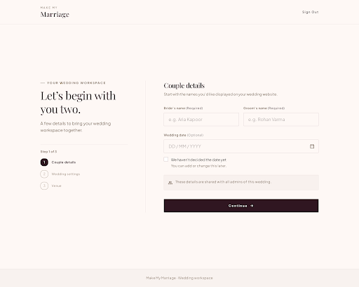
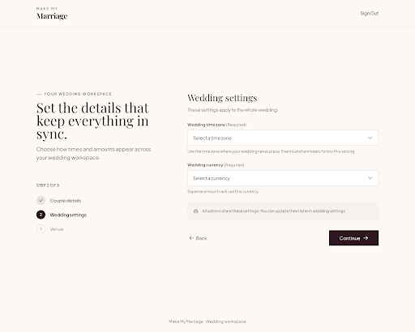
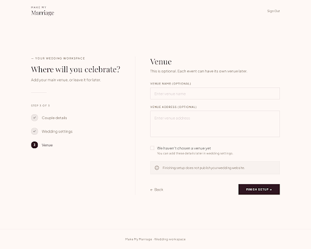
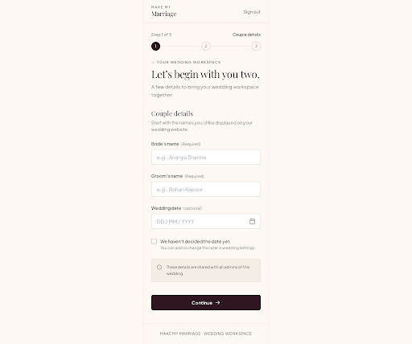
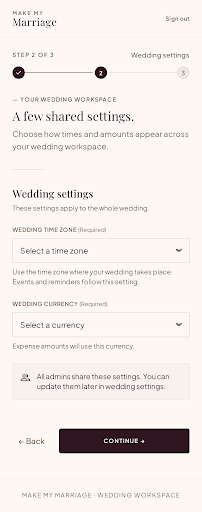
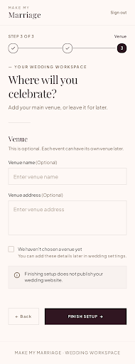
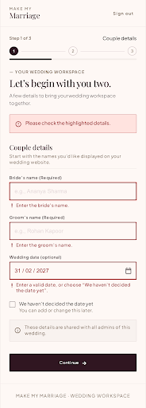
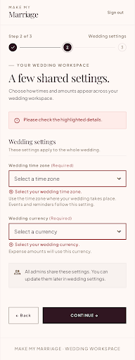
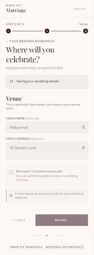
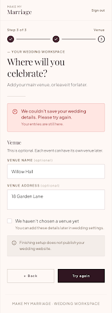

# Design System: Make My Marriage Wedding Onboarding

Status: design direction accepted; all three onboarding steps and persistence are implemented.
Updated 12 October 2026.
See [implementation status](Implementation.md) for the working flow, backend and actual checks.
Scope: three approved desktop screens, three mobile drafts, and four mobile
validation/save-state drafts with one shared visual language.
Source: approved homepage and workspace sign-in in Stitch project 12751053601206958162.
User-approved branding takes precedence over generic skill defaults.

## 1. Visual Theme & Atmosphere

Warm, calm wedding stationery translated into an efficient form. Airy density 3/10,
asymmetric layout 5/10, restrained motion 2/10. Continue the existing account-screen
identity rather than introducing a new dashboard theme. No large wedding photos
or invented wedding details during setup. A small botanical line drawing is sufficient.

## 2. Color Palette & Roles

- Warm blush canvas #FEF8F5: page background.
- Charcoal ink #1D1B19: body text; never pure black.
- Deep plum #301621: primary action, headings, active progress, focus outline.
- Warm muted ink #705A45: secondary copy.
- Soft bronze #99816A: decorative rules, not small body text.
- Linen #F7F3EB and pale panel #F8F2EF: restrained supporting surfaces.
  Use the approved plum as the single action accent; no new bright colors, gradients or glows.

## 3. Typography Rules

Use the project's existing Playfair Display for the editorial welcome headline
and Plus Jakarta Sans for all form labels, controls, body copy and progress.
This approved pairing is retained rather than replacing it with generic skill defaults.
Headline 40–48px desktop / 30–34px mobile; body 16px, relaxed 1.5 line height,
labels 12–14px with readable contrast. Copy line length at most 60 characters.

## 4. Component Stylings

Inputs: permanent labels above, 48–52px height, subtle border, 4–6px corner radius,
visible plum focus ring, errors below. Required state in text, not color alone.
Buttons: 48px minimum, plum fill and white label; secondary actions simple text.
One primary Continue button. No oversized rounded card enclosing the whole page.
Progress: three numbered stages with text labels, not a fake percentage.
Checkbox: "We haven't decided the date yet"; selected state disables the date field
and explains it can be added later. Do not prefill sample couple names or a date.
Loading and save errors must preserve input and avoid implying a completed save.
Date selection supports an explicit accessible day/month/year format in implementation.

## 5. Layout Principles

Minimal header: brand at left, Sign out at right. No dashboard/sidebar during setup.
Desktop centered 1120px content container with 40/60 editorial/form split and a
fine vertical separator. Left welcome copy and vertical step indicator; right
step title, field group, and actions. Subtle footer.
Below 768px: single column, compact welcome, stacked fields, 24px page padding.
Touch targets at least 44px; no horizontal overflow at 320px.
The form is the visual focus, not decoration.

## 6. Motion & Interaction

Brief 120–180ms opacity/transform transitions for focus and step changes.
No perpetual form animation or distracting loops; respect reduced motion.
Keyboard order follows visible layout. Associate errors and helpers with controls.
Show "Step 1 of 3" and "Couple details", followed by "Wedding settings", then "Venue".
Names, time zone and currency are the required setup fields.
Date may be undecided; venue is optional. Never infer time zone/currency from the
developer's machine. Details apply to one shared wedding, not per-admin weddings.
No "skip onboarding" CTA. Existing admins should use existing saved details.
Completion does not automatically publish the guest website.

## 7. Anti-Patterns

No neon, purple/blue gradients, emoji, glow, excessive shadow, tiny low-contrast
labels, floating labels, decorative photos, fabricated stats, overlapping text,
three feature-card columns, marketing claims or unrelated account verification.
Keep implementation details and database/provider names out of the product copy.

## 8. Stitch Review Reference

Project: [Make My Marriage](https://stitch.withgoogle.com/projects/12751053601206958162).
Refined desktop screen: 635d60d2ccc3438090ad4b4268ba0efe.
Original draft: 5b624f46770640df9549f4b161354434.

All three desktop screens were visually approved by the user. The mobile/state
references were accepted as the direction for initial implementation. Generated
placeholder names are examples, not saved values.
The original screenshots are visual references. Current implementation and actual
checks are recorded separately in [implementation status](Implementation.md).

## 9. Wedding Settings — Step 2 Draft

Stitch screen: 2cc78eea96cd4950b1a581f1855b1456.

- Required time zone and currency selectors, both initially unselected.
- Explain that events/reminders use the wedding time zone and expenses use its currency.
- One shared wedding; settings apply to all admins.
- Back and Continue actions; no privacy, budget, or publication controls.
- Editing settings after events or expenses exist needs its own rules when those features arrive.

## 10. Venue — Step 3 Draft

Stitch screen: 39221bf64cfc4d05b71d20a605bc4a09.

- Optional venue name and address; no maps provider or address lookup.
- Undecided-venue checkbox will disable venue fields during implementation.
- Setup can finish with blank venue details. Events may have their own venues later.
- Back and Finish setup actions; setup completion does not publish the guest website.

Both screens were visually inspected for the intended composition and copy.
These screenshots are design references; all three working forms and their
verification are recorded in [implementation status](Implementation.md).

## 11. Mobile and Interaction-State Drafts

### Couple details — mobile

Stitch screen: be8cee3537e040d2bbaf542837fc3aef.

### Wedding settings — mobile

Stitch screen: e6b968cf22b64aa89af8bafeccae2cbd.

### Venue — mobile

Stitch screen: e40469cd6ed443239bc94141224c4558.

### Couple details — validation

Stitch screen: 49d3755085fb4f5485c08e8ccc7be6d0.

### Wedding settings — validation

Stitch screen: 6bbf411d3627411893f7e43cd1dc3a16.

### Venue — saving

Stitch screen: 1d96f73d340e42dd9b44da0032e32ae6.

### Venue — save failed

Stitch screen: 56aef79a4c6f4a85acee3d3f851290ad.

## 12. Behavior to Implement and Verify

- Stack mobile fields and keep actions in document flow; check 320px and 390px
  layouts, zoom, and the phone keyboard during implementation.
- Validate both required names. An empty optional date is allowed; a provided
  invalid date needs a clear error or the undecided option.
- Require an explicit valid time zone and currency, never a machine-derived default.
- Show a form summary and inline errors; focus the first invalid field and associate
  messages with inputs. These are intended behaviors, not tested interactions.
- Venue name/address remain optional; do not prevent completion for blank fields.
- During saving, preserve values, disable repeat submission and step navigation,
  announce the pending status, and avoid showing success before confirmation.
- If saving fails, preserve all step values, show a safe message and enable retry.
  The examples are fictional; browser tests use them only in disposable database
  fixtures, never as application data.
- Completion does not publish the website. Resume, concurrent-save protection and
  authenticated setup redirects are now implemented; see the implementation record.

Exported previews were visually inspected and inconsistent generated header/footer
elements corrected. Screenshots alone do not verify control sizes, contrast,
responsive behavior, validation or persistence. All three steps, saving, resume and completion are implemented and checked;
see [implementation status](Implementation.md) for verification and remaining scope.
